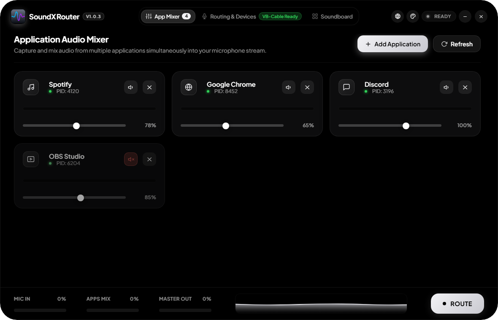

<div align="center">


**L'outil studio de routage et de mixage audio multi-applications pour streamers, joueurs et créateurs.**

[](https://github.com/eYushaa/SoundXRouter/releases/latest)
[](https://www.python.org/)
[](https://www.microsoft.com/windows)
[](https://github.com/eYushaa/SoundXRouter)

**Langues :**
[English](../../README.md) ·
[Türkçe](README.tr.md) ·
[العربية](README.ar.md) ·
[Русский](README.ru.md) ·
[简体中文](README.zh.md) ·
[日本語](README.ja.md) ·
[עברית](README.he.md) ·
**Français** ·
[Deutsch](README.de.md) ·
[Español](README.es.md)

</div>

---

## Nouveautés de la V1.0.3 (Changelog)

- **8 Thèmes Studio :** Sélecteur de thème intégré incluant **Verre Liquide (Liquid Glass)**, **Indigo Minuit**, **Blanc Lumière du Jour**, **Noir Pur AMOLED**, **Cyberpunk Néon**, **Forêt Émeraude**, **Coucher de Soleil** et **Nordique**, avec contrastes optimisés et palettes d'oscilloscope assorties.
- **10 Langues & Détection Automatique :** Interface complète en **English, Türkçe, العربية, Русский, 简体中文, 日本語, עברית, Français, Deutsch et Español**. Au premier lancement, la langue de Windows est détectée automatiquement (anglais par défaut si non prise en charge) et reste modifiable à tout moment depuis l'en-tête.
- **Refonte complète en icônes SVG vectorielles :** Remplacement de tous les émojis par des icônes SVG nettes et adaptées aux thèmes dans les onglets, cartes d'applications, contrôles muet, alertes et boutons du Soundboard.
- **Typographie par écriture & support RTL complet :** Polices dédiées (`Plus Jakarta Sans`, `Inter`, `Cairo`, `Rubik`, `Noto Sans SC`, `Noto Sans JP`), taille de police agrandie hors japonais pour une meilleure lisibilité, mise en page complète de droite à gauche (`RTL`) pour l'arabe et l'hébreu, et correction BiDi des parenthèses dans les menus déroulants de périphériques.
- **En-tête parfaitement centré & corrections visuelles :** Grille d'en-tête symétrique à 3 colonnes (`1fr auto 1fr`) maintenant les onglets strictement centrés (`0px` de décalage) lorsque le routage devient actif, suppression des bordures noires aux coins arrondis, bouton d'action raccourci en **DÉMARRER / ARRÊTER**, et polyfill `flex-gap` pour QtWebEngine Chromium 83.

---

## Captures d'écran

> Captures d'écran réalisées sur la version anglaise V1.0.3.

| Mixeur audio d'applications | Routage & Périphériques |
| :---: | :---: |
|  |  |

| Soundboard intégré | Thèmes Blanc Lumière du Jour & Noir Pur AMOLED |
| :---: | :---: |
|  |  |

<div align="center">



</div>

---

## Qu'est-ce que SoundX Router ?

**SoundX Router** est votre laboratoire sonore sur mesure sous Windows. Fini le micro brut et sans vie : fusionnez votre voix en temps réel avec vos morceaux, vos jeux, votre navigateur, des ambiances immersives et vos effets de soundboard dans un mélange unique, puis routez cette alchimie audio sur-mesure directement vers Discord, OBS Studio, vos jeux ou l'Enregistreur vocal.

### Fonctionnalités principales

1. **Mixeur audio multi-applications en temps réel :** Capturez et mixez l'audio de plusieurs applications vers votre flux micro avec curseurs indépendants (`0–150%`), bouton muet et vumètres par application.
2. **Pont micro virtuel :** Envoyez votre mix vers **SteelSeries Sonar - Microphone**, **VB-Audio Virtual Cable** ou tout autre pilote virtuel.
3. **Copie en 1 clic & Son test :** Copiez le nom du périphérique cible et envoyez un signal test pour vérifier immédiatement le niveau dans Discord ou OBS.
4. **Protection anti-boucle (Feedback) :** Détecte si le même périphérique virtuel est sélectionné en entrée et en sortie pour éviter tout larsen.
5. **Écoute casque intelligente (Smart Preview) :** Écoutez le mix final dans votre vrai casque sans le renvoyer dans votre microphone.
6. **Vumètres & Oscilloscope en direct :** Niveaux en temps réel pour **Entrée Micro**, **Mix Apps** et **Sortie Master**.
7. **Préréglages & Sauvegarde automatique :** Enregistrez vos profils dans `presets.json`; vos applications, niveaux, thème et langue sont sauvegardés dans `config.json`.
8. **Soundboard intégré :** Déclenchez des boucles d'ambiance depuis `sounds/` via des raccourcis clavier globaux (`keybinds.json`), même en jeu plein écran.

---

## Installation

Vous pouvez installer SoundX Router facilement en téléchargeant et en exécutant simplement `SoundXRouter-Setup.exe` depuis la page [Releases](https://github.com/eYushaa/SoundXRouter/releases).

---

## Configuration recommandée Discord / OBS

| Paramètre SoundX Router | Sélection dans SoundX Router | Entrée micro dans Discord / OBS |
| --- | --- | --- |
| **Microphone / Entrée principale** | Micro USB ou `CABLE Output (VB-Audio Virtual Cable)` | — |
| **Sortie virtuelle Master** | `SteelSeries Sonar - Microphone` ou `CABLE Input` | Choisissez le périphérique micro correspondant (`CABLE Output` ou `SteelSeries Sonar`) |
| **Écoute casque** | Votre casque ou haut-parleurs réels | Sélectionnez votre casque réel en sortie |

---

## Structure du projet

```text
SoundXRouter/
├── app.py                  # Serveur Flask + fenêtre PyQt5 QtWebEngine sans bordure
├── audio_manager.py        # Détection des périphériques, routage & gestion des préréglages
├── audio_engine.py         # Moteur audio faible latence sounddevice/numpy
├── app_audio_manager.py    # Capture WASAPI par processus (proctap + pycaw)
├── device_helper.py        # Utilitaires registre Windows & points de terminaison audio
├── hotkey_manager.py       # Gestionnaire global de raccourcis clavier du Soundboard
├── requirements.txt        # Dépendances Python
├── templates/index.html    # Modèle HTML principal de l'interface studio
├── static/                 # Modules CSS, thèmes, i18n, polyfill flex-gap, JS & logo.ico
└── docs/                   # READMEs localisés et captures d'écran
```

---

<div align="center">

**Conçu avec soin par eYushaa**  
*Contrôlez votre son, maîtrisez votre stream.*

</div>
