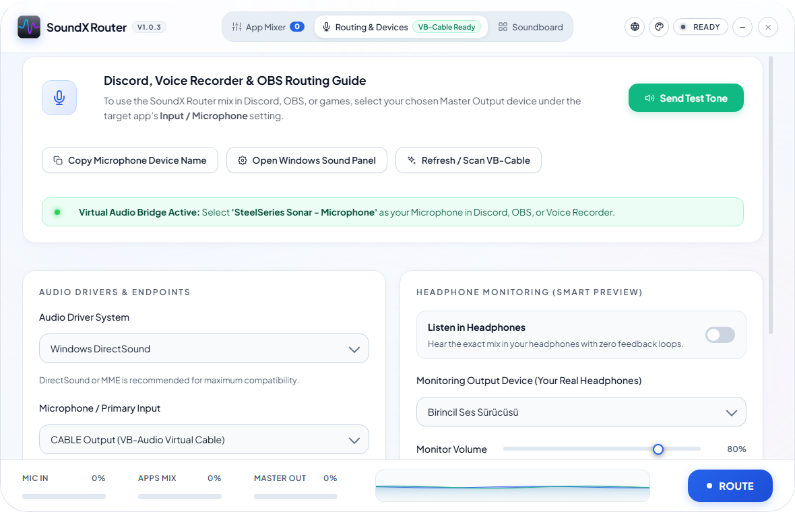

<div align="center">


**כלי אולפן מתקדם לניתוב ומיקס שמע בין אפליקציות עבור סטרימרים, גיימרים ויוצרים ב-Windows.**

[](https://github.com/eYushaa/SoundXRouter/releases/latest)
[](https://www.python.org/)
[](https://www.microsoft.com/windows)
[](https://github.com/eYushaa/SoundXRouter)

**שפות:**
[English](../../README.md) ·
[Türkçe](README.tr.md) ·
[العربية](README.ar.md) ·
[Русский](README.ru.md) ·
[简体中文](README.zh.md) ·
[日本語](README.ja.md) ·
**עברית** ·
[Français](README.fr.md) ·
[Deutsch](README.de.md) ·
[Español](README.es.md)

</div>

---

<div dir="rtl">

## מה חדש בגרסה V1.0.3 (Changelog)

- **8 ערכות נושא אולפניות:** בורר ערכות נושא מובנה הכולל **Liquid Glass**, **אינדיגו חצות**, **לבן יום (Light)**, **שחור AMOLED טהור**, **ניאון סייברפאנק**, **יער אמרלד**, **שקיעה חמה** ו**נורד ארקטי**, עם ניגודיות מכוילת ופלטות גלי קול תואמות.
- **תמיכה ב-10 שפות וזיהוי אוטומטי:** ממשק מלא ב-**עברית, English, Türkçe, العربية, Русский, 简体中文, 日本語, Français, Deutsch ו-Español**. בהפעלה הראשונה האפליקציה מזהה אוטומטית את שפת מערכת Windows (או חוזרת לאנגלית) ומאפשרת החלפה מיידית מהכותרת.
- **מעבר מלא לאייקוני SVG וקטוריים:** כל האמוג'ים בלשוניות הניווט, כרטיסי המיקסר, כפתורי ההשתקה, ההתראות ולוח הצלילים הוחלפו באייקוני SVG חדים התואמים לכל ערכת נושא.
- **טיפוגרפיה מותאמת כתב ותמיכת RTL מלאה:** גופנים מותאמים לעברית (`Rubik` / `Heebo`) ולערבית (`Cairo`), הגדלת גופנים לשיפור הקריאות בכל השפות שאינן יפנית, פריסת ימין-לשמאל (`RTL`) מלאה ותיקון BiDi להצגה מדויקת של סוגריים בשמות התקנים כמו `CABLE Output (VB-Audio Virtual Cable)`.
- **מרכוז כותרת מדויק ושיפורי תצוגה:** רשת כותרת סימטרית (`1fr auto 1fr`) השומרת על לשוניות הניווט ממורכזות לחלוטין (`0px` סטייה) בעת שידור חי, הסרת שוליים כהים בפינות החלון המעוגלות, יישור כפתור ההפעלה/עצירה בשורה אחת עם אוסצילוסקופ הגלים ותאימות `flex-gap` למנוע Chromium 83 ב-QtWebEngine.

</div>

---

## צילומי מסך

> צילומי המסך צולמו בגרסה האנגלית של V1.0.3.

| מיקסר שמע לאפליקציות | ניתוב והתקנים |
| :---: | :---: |
|  |  |

| לוח צלילים משולב (Soundboard) | ערכות נושא לבן יום ושחור AMOLED |
| :---: | :---: |
|  |  |

<div align="center">


</div>

---

<div dir="rtl">

## מהו SoundX Router?

**SoundX Router** הוא מעבדת האלכימיה הקולית האישית שלך ב-Windows. תשכח משידור של מיקרופון יבש ובודד: מזג את הקול שלך בזמן אמת עם מוזיקה, צלילי משחקים, לשוניות דפדפן, אווירת רקע חיה ואפקטים מלוח הצלילים לכדי שיקוי שמע ייחודי משלך — ונתב את התמהיל הזה כזרם מיקרופון חד וצלול ישירות אל Discord, OBS Studio, משחקים או רשמקול Windows.

### יכולות עיקריות

1. **מיקסר שמע בזמן אמת:** לכידה ומיזוג של שמע מתוכנות מרובות ישירות אל זרם המיקרופון עם מחווני עוצמה נפרדים (`0–150%`), כפתור השתקה ומדי VU לכל אפליקציה.
2. **גשר מיקרופון וירטואלי:** העברת המיקס הסופי אל **SteelSeries Sonar - Microphone**, **VB-Audio Virtual Cable** או כל מנהל התקן וירטואלי אחר.
3. **העתקה בלחיצה אחת וצליל בדיקה:** העתק את שם התקן היציאה בלחיצה אחת ושלח צליל בדיקה לאימות עוצמת המיקרופון ב-Discord או ב-OBS.
4. **הגנה מפני לולאת משוב (Feedback Loop):** מזהה אוטומטית אם נבחר אותו כבל וירטואלי לקלט ולפלט ומציג אזהרה למניעת הדים וצפצופים.
5. **ניטור חכם באוזניות (Smart Preview):** האזן בדיוק למה שיוצא לשידור באוזניות האמיתיות שלך בלי החזרת שמע למיקרופון.
6. **מדי VU ואוסצילוסקופ חיים:** מדידה רציפה עבור **כניסת מיקרופון**, **מיקס אפליקציות** ו**יציאה ראשית**.
7. **ערכות מוגדרות מראש (Presets) ושמירה אוטומטית:** שמור תצורות שלמות ב-`presets.json`; רשימת האפליקציות, העוצמות, ערכת הנושא והשפה נשמרות אוטומטית ב-`config.json`.
8. **לוח צלילים משולב (Soundboard):** הפעל לולאות רקע ואפקטים מתוך `sounds/` באמצעות קיצורי מקלדת גלובליים (`keybinds.json`) גם במהלך משחקים במסך מלא.

---

## התקנה

ניתן להתקין את SoundX Router בקלות פשוט על ידי הורדה והרצה של `SoundXRouter-Setup.exe` מדף ה-[Releases](https://github.com/eYushaa/SoundXRouter/releases).

---

## הגדרות מומלצות ל-Discord / OBS

</div>

| הגדרה ב-SoundX Router | בחירה באפליקציה | הגדרת מיקרופון ב-Discord / OBS |
| --- | --- | --- |
| **מיקרופון / קלט ראשי** | מיקרופון USB או `CABLE Output (VB-Audio Virtual Cable)` | — |
| **יציאה וירטואלית ראשית** | `SteelSeries Sonar - Microphone` או `CABLE Input` | בחר את התקן הקלט התואם (`CABLE Output` או `SteelSeries Sonar`) |
| **ניטור אוזניות** | האוזניות או הרמקולים הפיזיים שלך | בחר באוזניות האמיתיות כהתקן פלט |

---

## מבנה הפרויקט / Project Structure

```text
SoundXRouter/
├── app.py                  # Flask server + frameless PyQt5 QtWebEngine window
├── audio_manager.py        # Device discovery, routing coordination & presets helper
├── audio_engine.py         # Low-latency sounddevice/numpy stream & ambience engine
├── app_audio_manager.py    # Per-process WASAPI loopback capture (proctap + pycaw)
├── device_helper.py        # Windows registry & audio endpoint helpers
├── hotkey_manager.py       # Global soundboard keyboard shortcuts manager
├── requirements.txt        # Python dependencies
├── templates/index.html    # Single-page studio UI template
├── static/                 # Modular CSS, themes, i18n, flex-gap polyfill, JS & logo.ico
└── docs/                   # Localized READMEs and screenshots
```

---

<div align="center">

**נוצר באהבה על ידי eYushaa**  
*שלוט בסאונד שלך, הובל את השידור.*

</div>
