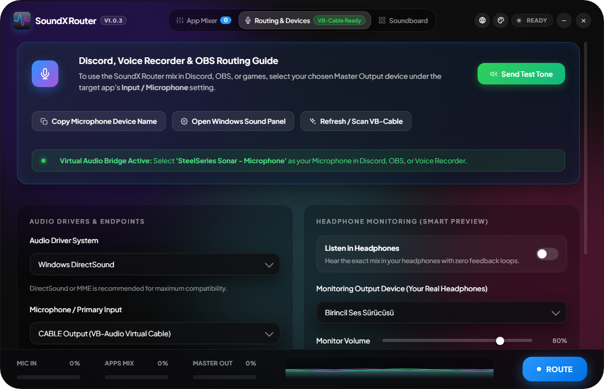

<div align="center">


**Студийный инструмент маршрутизации и микширования звука приложений для стримеров, геймеров и авторов.**

[](https://github.com/eYushaa/SoundXRouter/releases/latest)
[](https://www.python.org/)
[](https://www.microsoft.com/windows)
[](https://github.com/eYushaa/SoundXRouter)

**Языки:**
[English](../../README.md) ·
[Türkçe](README.tr.md) ·
[العربية](README.ar.md) ·
**Русский** ·
[简体中文](README.zh.md) ·
[日本語](README.ja.md) ·
[עברית](README.he.md) ·
[Français](README.fr.md) ·
[Deutsch](README.de.md) ·
[Español](README.es.md)

</div>

---

## Что нового в V1.0.3 (Changelog)

- **8 студийных тем оформления:** Переключатель тем в шапке с режимами **Liquid Glass**, **Полночный индиго**, **Дневной белый (Light)**, **Чистый чёрный AMOLED**, **Киберпанк неон**, **Изумрудный лес**, **Тёплый закат** и **Арктический Nord** с адаптированной контрастностью и палитрами осциллографа.
- **10 языков и автоопределение языка ОС:** Полный перевод интерфейса на **English, Türkçe, العربية, Русский, 简体中文, 日本語, עברית, Français, Deutsch и Español**. При первом запуске программа автоматически определяет язык Windows (иначе используется английский), а сменить язык можно в любой момент.
- **Переход на векторные SVG-иконки:** Все эмодзи во вкладках, карточках приложений, кнопках отключения звука, уведомлениях и панели звуков заменены на чёткие SVG-иконки, подстраивающиеся под тему.
- **Типографика под каждую письменность и полная поддержка RTL:** Подобранные шрифтовые стеки (`Plus Jakarta Sans`, `Inter`, `Cairo`, `Rubik`, `Noto Sans SC`, `Noto Sans JP`), увеличенные размеры шрифтов для неяпонских языков, зеркальная вёрстка RTL для арабского и иврита и исправление BiDi-порядка скобок в выпадающих списках устройств.
- **Идеальное выравнивание и полировка рендеринга:** Симметричная 3-колоночная шапка (`1fr auto 1fr`) удерживает вкладки строго по центру (`0px` смещения) при включении маршрутизации; убраны полупрозрачные тёмные углы окна; кнопка запуска в подвале выровнена по уровню с осциллографом; добавлен полифилл `flex-gap` для QtWebEngine Chromium 83.

---

## Скриншоты

> Скриншоты сделаны в английской версии интерфейса V1.0.3.

| Микшер аудио приложений | Маршрутизация и устройства |
| :---: | :---: |
|  |  |

| Встроенный Soundboard | Светлая тема и Чистый чёрный AMOLED |
| :---: | :---: |
|  |  |

<div align="center">


</div>

---

## Что такое SoundX Router?

**SoundX Router** — это ваша личная алхимическая звуковая студия для Windows. Хватит отправлять сухой и одинокий сигнал микрофона: сплетайте свой голос в реальном времени с музыкой, звуками игр, вкладками браузера, живым эмбиентом и эффектами саундборда в неповторимый звуковой коктейль — и маршрутизируйте этот микс единым чистым потоком прямо в Discord, OBS Studio, игры или Диктофон.

### Основные возможности

1. **Микшер приложений в реальном времени:** Захват и смешивание звука нескольких программ прямо в микрофонный поток с раздельными ползунками (`0–150%`), кнопкой Mute и индикаторами VU.
2. **Мост виртуального микрофона:** Вывод готового микса в **SteelSeries Sonar - Microphone**, **VB-Audio Virtual Cable** или любой виртуальный драйвер.
3. **Копирование имени и тестовый сигнал:** Копируйте имя устройства в 1 клик и отправляйте тестовый тон для проверки уровня в Discord или OBS.
4. **Защита от обратной связи (Feedback Loop):** Автоматически предупреждает, если для входа и выхода выбран один и тот же виртуальный кабель.
5. **Умный мониторинг в наушниках (Smart Preview):** Прослушивайте точный исходящий микс в наушниках без попадания эха обратно в микрофон.
6. **Живые VU-метры и осциллограф:** Индикация **Вход Мик**, **Микс Прил.** и **Выход** в нижней панели.
7. **Пресеты и автосохранение:** Сохраняйте профили в `presets.json`; активные приложения, уровни громкости, тема и язык сохраняются в `config.json`.
8. **Встроенный Soundboard:** Фоновые петли и звуковые эффекты из `sounds/` по глобальным горячим клавишам (`keybinds.json`) даже в полноэкранных играх.

---

## Установка

Вы можете легко установить SoundX Router, скачав и запустив `SoundXRouter-Setup.exe` со страницы [Releases](https://github.com/eYushaa/SoundXRouter/releases).

---

## Рекомендуемая настройка для Discord / OBS

| Настройка в SoundX Router | Выбор в SoundX Router | Вход микрофона в Discord / OBS |
| --- | --- | --- |
| **Микрофон / Основной вход** | USB-микрофон или `CABLE Output (VB-Audio Virtual Cable)` | — |
| **Главный виртуальный выход** | `SteelSeries Sonar - Microphone` или `CABLE Input` | Выберите соответствующий микрофон (`CABLE Output` или `SteelSeries Sonar`) |
| **Мониторинг в наушниках** | Ваши реальные наушники / динамики | Выберите наушники как устройство вывода |

---

## Структура проекта

```text
SoundXRouter/
├── app.py                  # Flask API-сервер + безрамочное окно PyQt5 QtWebEngine
├── audio_manager.py        # Поиск устройств, координация маршрутизации и пресеты
├── audio_engine.py         # Низколатентный движок микширования sounddevice/numpy
├── app_audio_manager.py    # Захват WASAPI по процессам (proctap + pycaw)
├── device_helper.py        # Помощники реестра Windows и аудиоустройств
├── hotkey_manager.py       # Глобальные горячие клавиши Soundboard
├── requirements.txt        # Зависимости Python
├── templates/index.html    # HTML-шаблон студийного интерфейса
├── static/                 # Модульные CSS, темы, i18n, polyfill flex-gap, JS и logo.ico
└── docs/                   # Документация README на 10 языках и скриншоты
```

---

<div align="center">

**Создано с заботой — eYushaa**  
*Управляй звуком, владей эфиром.*

</div>
