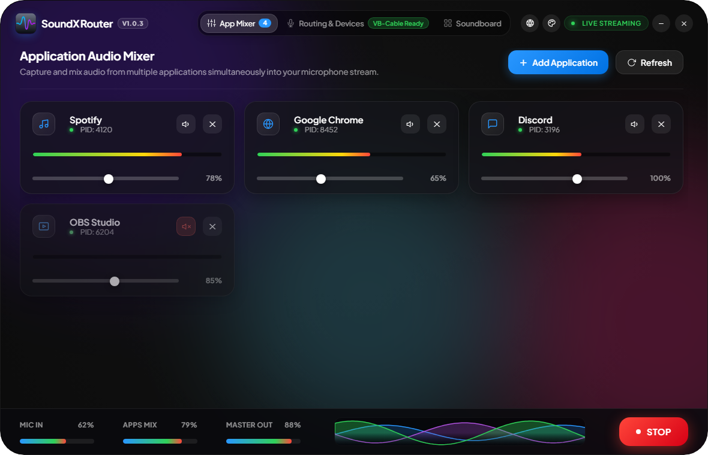
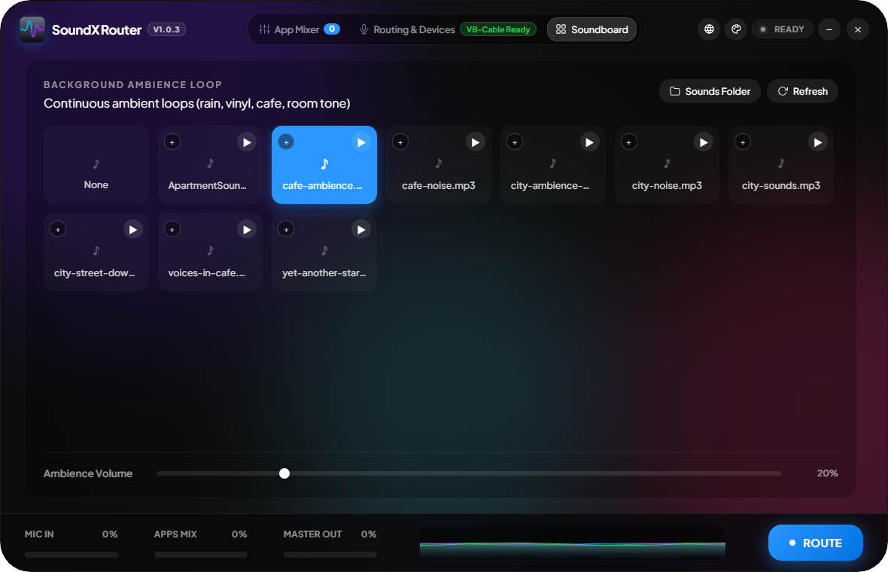

<div align="center">


**Yayıncılar, Oyuncular ve İçerik Üreticileri için Stüdyo Düzeyinde Ses Yönlendirme ve Miksleme Aracı.**

[](https://github.com/eYushaa/SoundXRouter/releases/latest)
[](https://www.python.org/)
[](https://www.microsoft.com/windows)
[](https://github.com/eYushaa/SoundXRouter)

**Diller:**
[English](../../README.md) ·
**Türkçe** ·
[العربية](README.ar.md) ·
[Русский](README.ru.md) ·
[简体中文](README.zh.md) ·
[日本語](README.ja.md) ·
[עברית](README.he.md) ·
[Français](README.fr.md) ·
[Deutsch](README.de.md) ·
[Español](README.es.md)

</div>

---

## V1.0.3 Sürüm Notları (Yenilikler)

- **8 Stüdyo Teması:** Üst çubuktaki tema seçiciyle anında değiştirilebilen **Sıvı Cam (Liquid Glass)**, **Gece İndigo**, **Gün Işığı Beyaz**, **Saf Siyah AMOLED**, **Cyberpunk Neon**, **Orman Yeşili**, **Gün Batımı** ve **Kuzey (Nord)** temaları; her temaya uyumlu osiloskop dalga formu paleti ve optimize edilmiş Açık/AMOLED kontrastları.
- **10 Dil Desteği ve Otomatik Dil Algılama:** **Türkçe, English, العربية, Русский, 简体中文, 日本語, עברית, Français, Deutsch ve Español** için tam arayüz çevirisi. İlk açılışta Windows sistem dilini otomatik algılar (listede yoksa İngilizce açılır) ve üst menüden istendiği an değiştirilebilir.
- **Vektörel SVG İkon Yenilemesi:** Sekmeler, uygulama mikser kartları, sessize alma düğmeleri, uyarı/bilgi kartları ve ses paneli butonlarındaki tüm emojiler tema rengine uyumlu keskin SVG ikonlarla değiştirildi.
- **Dile Özgü Tipografi ve Tam RTL Desteği:** Latin, Kiril, Arapça (`Cairo`), İbranice (`Rubik`) ve CJK (`Noto Sans SC / JP`) alfabeleri için özel yazı tipleri; Japonca dışındaki dillerde büyütülmüş okunaklı yazı boyutları; Arapça ve İbranice için tam sağdan sola (`RTL`) yerleşim ve aygıt adlarındaki parantez ters dönmesini engelleyen BiDi düzeltmesi.
- **Başlık Hizalama ve Performans İyileştirmeleri:** Yönlendirme başlatıldığında sağ üstteki durum bildiricinin orta sekme panelini kaydırmasını önleyen simetrik 3 sütunlu (`1fr auto 1fr`) ızgara düzeni (`0px` sapma), yuvarlatılmış pencere köşelerindeki siyah şeffaflık hatasının giderilmesi, sadeleştirilmiş **BAŞLAT / DURDUR** düğmesi ve QtWebEngine Chromium 83 için `flex-gap` desteği.

---

## Ekran Görüntüleri

> Arayüz görselleri V1.0.3 İngilizce sürüm üzerinden alınmıştır.

| Uygulama Ses Mikseri | Yönlendirme & Aygıtlar |
| :---: | :---: |
|  |  |

| Entegre Ses Paneli (Soundboard) | Gün Işığı Beyaz ve Saf Siyah AMOLED Temaları |
| :---: | :---: |
|  |  |

<div align="center">


</div>

---

## SoundX Router Nedir?

**SoundX Router**, sıradan ve kupkuru bir mikrofon sesi göndermeyi tarihe gömen kişisel ses harmanlama stüdyonuzdur. Mikrofonunuzdan gelen canlı sesinizi; arka planda çalan müziklerle, oyun sesleriyle, tarayıcı sekmeleriyle, ortam ambiyanslarıyla ve soundboard efektleriyle gerçek zamanlı bir potada eritip kusursuz bir karışıma dönüştürebilir, ortaya çıkan bu özgün ses kokteylini tek bir akış hâlinde doğrudan Discord, OBS Studio, oyunlar veya Ses Kaydedici'ye yönlendirebilirsiniz.

### Temel Özellikler

1. **Gerçek Zamanlı Çoklu Uygulama Mikseri:** Açık uygulamaların sesini `%0–150` bağımsız ses kaydırıcıları, anlık sessize alma ve uygulama bazlı VU göstergeleriyle mikrofon akışınıza karıştırın.
2. **Sanal Mikrofon Köprüsü:** Miksi **SteelSeries Sonar - Microphone**, **VB-Audio Virtual Cable** veya herhangi bir sanal mikrofon sürücüsüne aktarın.
3. **Tek Tıkla Aygıt Kopyalama ve Test Sesi:** Discord/OBS için hedef mikrofon adını tek tıkla kopyalayın ve test tonu göndererek giriş seviyesini doğrulayın.
4. **Geri Besleme (Feedback Loop) Koruması:** Giriş ve çıkış için yanlışlıkla aynı sanal kablo seçildiğinde otomatik uyarı verir.
5. **Akıllı Kulaklık İzleme (Smart Preview):** Mikrofona yankı veya döngü vermeden giden miksi doğrudan gerçek kulaklığınızdan dinleyin.
6. **Canlı VU Metreler ve Osiloskop:** Alt panelde **Mikrofon**, **Uygulamalar** ve **Ana Çıkış** için anlık seviye ölçümü ve dalga formu animasyonu.
7. **Presetler ve Otomatik Kayıt:** Tüm cihaz/ses düzenlerini `presets.json` dosyasına kaydedin; son ayarlarınız, temanız ve dil seçiminiz `config.json` içinde saklanır.
8. **Entegre Ses Paneli (Soundboard):** `sounds/` klasöründeki ortam döngülerini ve ses efektlerini tam ekran oyunlarda bile global kısayollarla (`keybinds.json`) çalın.

---

## Kurulum

SoundX Router'ı [Releases](https://github.com/eYushaa/SoundXRouter/releases) sayfasından `SoundXRouter-Setup.exe` dosyasını indirip çalıştırarak kolayca kurabilirsiniz.

---

## Discord / OBS Önerilen Ayarlar

| SoundX Router Ayarı | SoundX Router Seçimi | Discord / OBS Mikrofon Ayarı |
| --- | --- | --- |
| **Mikrofon / Birincil Giriş** | USB Mikrofonunuz veya `CABLE Output (VB-Audio Virtual Cable)` | — |
| **Master Sanal Çıkış** | `SteelSeries Sonar - Microphone` veya `CABLE Input` | Karşılık gelen mikrofon girişini (`CABLE Output` veya `SteelSeries Sonar`) seçin |
| **Kulaklık İzleme** | Gerçek Kulaklığınız / Hoparlörünüz | Çıkış aygıtı olarak kulaklığınızı seçin |

---

## Proje Yapısı

```text
SoundXRouter/
├── app.py                  # Flask API sunucusu + çerçevesiz PyQt5 QtWebEngine penceresi
├── audio_manager.py        # Aygıt tarama, yönlendirme koordinasyonu ve preset yardımcıları
├── audio_engine.py         # Düşük gecikmeli sounddevice/numpy ses ve ortam miks motoru
├── app_audio_manager.py    # Süreç bazlı WASAPI loopback yakalama (proctap + pycaw)
├── device_helper.py        # Windows kayıt defteri ve ses uç noktası yardımcıları
├── hotkey_manager.py       # Global Soundboard klavye kısayolu yöneticisi
├── requirements.txt        # Python bağımlılıkları
├── templates/index.html    # Ana uygulama arayüzü HTML şablonu
├── static/                 # Modüler CSS, temalar, i18n, flex-gap polyfill, JS ve logo.ico
└── docs/                   # 10 dilde README belgeleri ve ekran görüntüleri
```

---

<div align="center">

**eYushaa tarafından özenle geliştirildi**  
*Sesini kontrol et, yayınına hükmet.*

</div>
